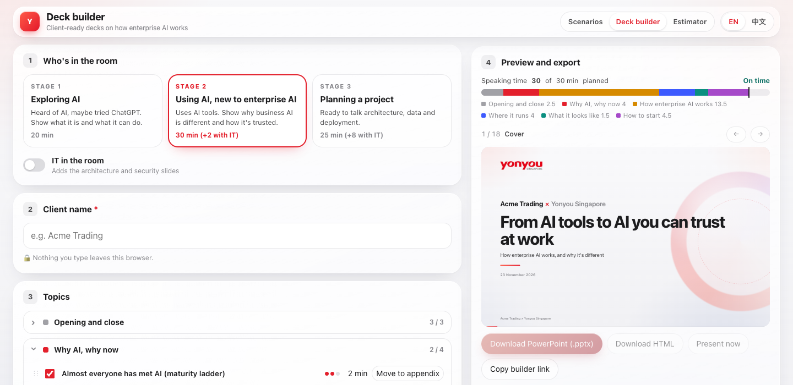
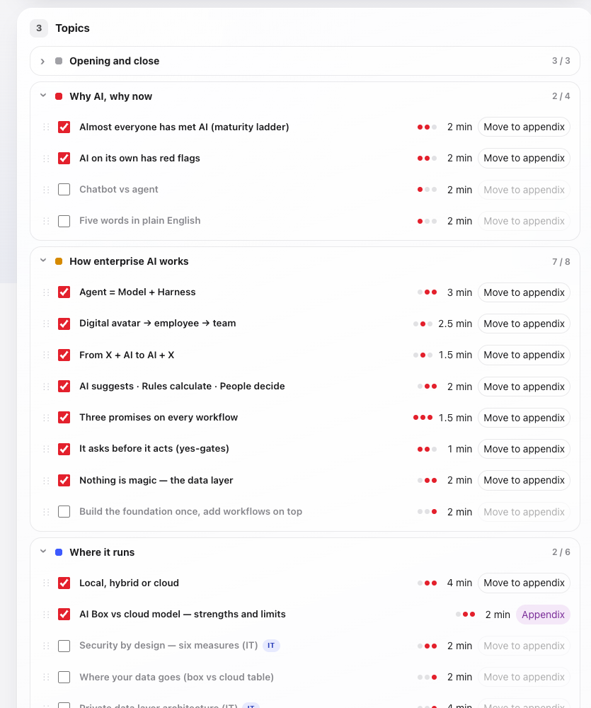
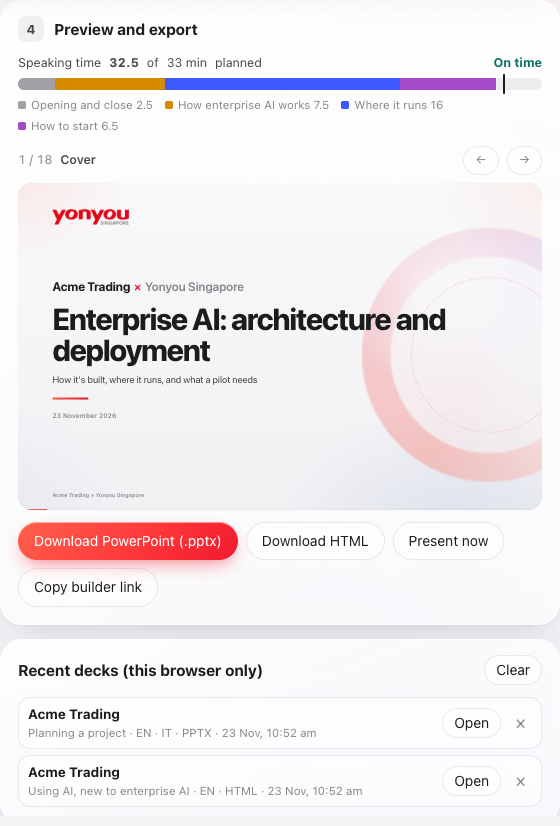
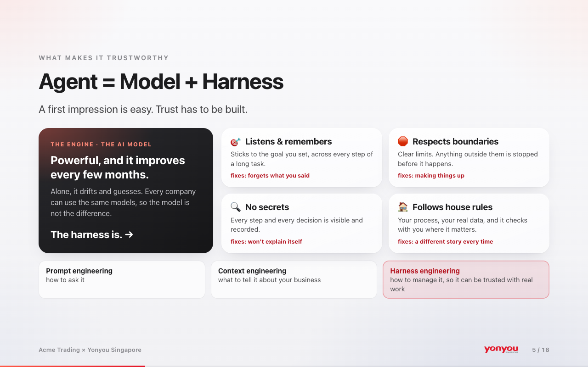

# YonWork Deck Builder

Build a client-ready deck on **how enterprise AI works, and why it can be trusted**, in about two minutes.
Pick who's in the room, type the client's name, export as **editable PowerPoint** or a **one-file HTML deck**.

One of three tools in the **YonWork Starter Pack**:
[Scenarios](https://yonyou.com.sg/yonwork-cases/) (see it working) ·
**Deck builder** (how it works) ·
[Estimator](https://chunnsshing.github.io/yonwork-estimator/) (what it costs).

**Privacy:** the builder is one static page. Nothing you type leaves your browser. There's no login, no server,
no analytics and no fonts or scripts loaded from anywhere else.

---

## For salespeople: four steps

**1 · Who's in the room.** Pick a stage card, and switch on *IT in the room* if IT is joining. The stage sets the
cover title, the topics and the planned length.

**2 · Client name.** Type it exactly as it should appear on the cover and footer. It's the only thing you type.



**3 · Topics.** Untick what you don't need, drag to reorder within a section, or *Move to appendix* to keep a slide
for questions. The time bar turns amber when you're over the planned time by 10%, and red at 25%.
Badges: **IT** (for IT audiences) · **中文待审** (Chinese not reviewed yet)
· **Check before use** (a fact on the slide is past its review date). Hover a row to see the slide.



**4 · Preview and export.**

| Button | What you get |
|---|---|
| **Download PowerPoint (.pptx)** | Editable slides in the current language, e.g. `2026-11-23_Acme_Trading_YonWork_AI_EN.pptx` |
| **Download HTML** | One file with both languages. Opens offline with a double-click; good for sharing |
| **Present now** | The HTML deck in a new tab |
| **Copy builder link** | A link that reopens this exact selection. **It includes the client name**, so share it only with colleagues |



**Presenting the HTML deck:** it fills the browser window at any size. `←` `→` / Space to move · `O` overview (the appendix is at the end) · `L` English ⇄ 中文 ·
`F` full screen · `H` hide the progress bar · `Esc` close. Clicking a self-check row or *Replay* doesn't change slides.



There are no speaker notes; you get a separate briefing. Pricing is in the Estimator, use cases in Scenarios.

---

## For editors

```
site.yaml                      stages, presets, IT overlay, sections, labels, brand tokens, starter-pack links
content/facts.yaml             model names, hardware, policies, statistics (with source + review_by). No prices.
content/modules/<section>/<id>.yaml   one slide each: EN in slide:, Chinese in zh:
layouts/<name>.html.js         HTML renderer      layouts/<name>.pptx.js   PowerPoint renderer (same data)
runtime/deck.css, deck.js      the HTML deck (shared tokens) · scenes.js for interactive slides
app/                           the builder page, UI strings in app/i18n.yaml
scripts/build.py               validate + build dist/index.html
```

### Change text on a slide
Edit the module file. Keep `slide:` (English) and `zh:` (Chinese) the **same shape**: same keys, same number of list
items. Limits: headings ≤ 70 characters (≤ 30 Chinese), card text ≤ 110 (≤ 50 Chinese). After editing Chinese, set
`zh_status: reviewed` once a native speaker has checked it.

### Add a module
1. Copy a module of the layout you want into `content/modules/<section>/<new-id>.yaml` (file name = `id`).
2. Set `origin: proposed`. It shows in the builder with a **Draft** badge and can't be exported.
3. When it's approved, set `origin: approved` and, if it belongs in a stage, add its id to `site.yaml` → `presets`.

### Update a fact
Edit `content/facts.yaml`: `value` (+ `value_zh` / `label_zh` if shown on a slide), `source`, `checked`, `review_by`.
Never type a model name, hardware name, statistic or `%` figure into a module; use `{{facts.<path>}}`.
Past `review_by` the build warns (and CI's `--strict` build fails) until the fact is checked again.

### Placeholders
`{{client}}` · `{{preset.title}}` · `{{preset.subtitle}}` · `{{facts.<path>}}`. An unknown one fails the build.

### Rules (enforced by `scripts/lint.py`)
No client or partner names, people, client figures or contact details anywhere, including tests and commit messages;
use *Acme Trading*. No prices. No claims that something is deployed or measured. No speaker notes. See `CLAUDE.md`.

---

## Build and check

```bash
pip install pyyaml
python scripts/build.py --strict          # → dist/index.html; must be 0 errors, 0 warnings
```

Dev checks (Python venv with `playwright`, `python-pptx`, `pillow`, `pymupdf`, `opencv-python-headless`;
Google Chrome; LibreOffice for PowerPoint renders):

```bash
.venv/bin/python scripts/screenshot.py    # every preset × IT × EN/ZH → shots/, fails on overflow or network requests
.venv/bin/python scripts/check_pptx.py    # export every preset as .pptx, check it, render to PNG via LibreOffice
.venv/bin/python scripts/test_builder.py  # drive the builder end to end
.venv/bin/python scripts/acceptance.py    # all of the above + HANDOFF §13 checklist
```

`raw/` (gitignored) holds the source decks and `raw/denylist.txt`; lint and the checks use the denylist when present.

## Deploy

Every push to `main` runs `.github/workflows/pages.yml`: `build.py --strict`, then publishes `dist/index.html` to
GitHub Pages. It goes live about a minute after the push, so check the local build first.

## Licences

Vendored, MIT: [PptxGenJS](vendor/pptxgenjs/LICENSE) (with JSZip) and
[qrcode-generator](vendor/qrcode-generator/LICENSE).
